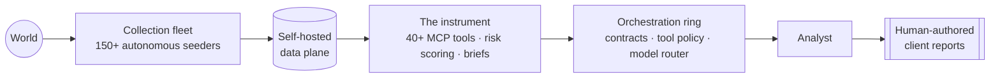

# the-synactic

**Praxen Development & Engineering** · Advanced Research Division

> A self-hosted geopolitical-intelligence instrument. Machine-scale collection,
> analyst-grade judgment, human-authored reports out.

**Status: in active build.** Private by design. What you're looking at is the
workshop door — not the machine.

---

## What's being built behind this door

the-synactic is Praxen's internal analytical instrument: a full-stack,
self-hosted intelligence platform that watches the world in real time and
answers hard questions with **provenance attached to every number**.

- **A global data plane** — 150+ autonomous collectors sweeping conflict
  events, sanctions programs, maritime chokepoints, energy flows, airspace,
  cyber threat feeds, macroeconomics, climate anomalies, and more into a
  self-contained cache layer. No third-party clouds custody the data.
- **An MCP-native tool surface** — 40+ typed, schema-verified tools any
  MCP-speaking agent can call: composite country-risk scoring, conflict-event
  retrieval, LLM-grounded country briefs, chokepoint status, prediction
  markets, and beyond. Server-side JMESPath projection keeps agent context
  windows lean.
- **A multi-model reasoning layer** — LLM routing across 190+ model
  endpoints with per-route budgets and capability-tiered fallback chains that
  terminate on local hardware. The instrument never goes dark because a cloud
  provider did.
- **A clean-room orchestration core** — original contracts, provenance
  envelopes, and a default-deny tool-policy engine (mutation-tested), built to
  put an agent council on rails rather than on vibes.
- **A semantic memory layer** *(in build)* — vector-indexed intel history for
  similar-event recall and retrieval-grounded report drafting.

<!-- [prototype screenshot slot: dashboard overview] -->

<!-- [prototype screenshot slot: country-risk MCP tool card] -->

## The silhouette

Machines collect and compute. A human signs every conclusion.

## How this workshop builds

The engineering culture is the product:

- **Contract truthing.** Every declared schema is verified against captured
  live payloads — oracle fixtures with explicit presence/absence assertions,
  because a validator that can't say *no* proves nothing. When declared
  contracts and reality disagreed, we fixed eight surfaces in one pass and
  pinned tests so the drift can never silently return.
- **Provenance discipline.** Claims carry labels — `[VERIFIED file:line]`,
  `[OPEN]`, `[BOUNDARY]`. Runtime values are never asserted from source alone.
  A green test suite is treated as evidence of exactly what it tests, and
  nothing more.
- **Fail loudly.** Degraded states announce themselves — no silent fallbacks
  between an upstream failure and a number that lands in a client deliverable.
  Cache writes are verified by reading them back. An HTTP 200 is not success;
  the persisted key is.
- **Adversarial review.** Substantive changes face independent reviewer fleets
  prompted to refute, not confirm. Findings survive or die on file:line
  evidence.
- **400+ tests in the clean-room core alone**, with mutation-tested guards on
  the security-relevant paths — plus the instrument's own multi-hundred-test
  battery, typechecks, secret scanning, and CI on every push.

<!-- [prototype screenshot slot: oracle contract suite green run] -->

## Design posture

- **Internal instrument.** No external users, no client logins, no exposed
  API. Intelligence flows out exclusively as human-authored reports.
- **Read-only by charter.** The instrument observes markets and events; it
  will never place an order, execute a trade, or move money. Permanently.
- **Self-contained.** One compose stack: app, relay, cache, verification
  tooling. Every fallback chain ends on hardware we own.

## Lineage

Built on the excellent AGPL-3.0
[WorldMonitor](https://github.com/koala73/worldmonitor) project — preserved
here as [UPSTREAM-WORLDMONITOR-README.md](UPSTREAM-WORLDMONITOR-README.md) —
then forked private, hardened for sovereign self-hosting, contract-truthed
end to end, and extended with Praxen's original clean-room core
([synactic/](synactic/README.md)). Upstream's honesty patterns didn't just
survive the fork; they were promoted to house style.

---

**Praxen Development & Engineering** — we build the machines that build the
briefings. © 2026. All rights reserved where applicable; upstream components
remain under their original licenses.
