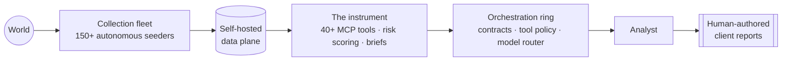

# the-synactic

**One instrument. A world of signals. Every claim accounted for.**

Praxen Development & Engineering · Advanced Research Division

the-synactic is Praxen's self-hosted geopolitical-intelligence instrument —
machine-scale collection, analyst-grade judgment, human-authored reports out.
In active build. Private by design. This page is the workshop door, not the
machine.

* * *

## Rent your intelligence, or own it

Rented intelligence looks like this: a SaaS dashboard you don't control,
metered API quotas, models that vanish on a vendor's schedule, and numbers
you're asked to trust because the interface looks confident.

the-synactic is the alternative. The collection fleet runs on hardware we
own. The data plane lives in a cache layer no third-party cloud custodies.
The reasoning layer routes across capability-tiered model chains that
terminate on local metal — the instrument never goes dark because someone
else's cloud did. And every figure that reaches a client deliverable carries
its provenance, because the difference between intelligence and content is
being able to say where a number came from.

## The live numbers

150+ autonomous collectors sweeping conflict events, sanctions programs,
maritime chokepoints, energy flows, airspace, cyber threat feeds,
macroeconomics, and climate anomalies. 40+ typed MCP tools any agent can
call — composite country-risk scoring, conflict-event retrieval,
LLM-grounded country briefs, chokepoint status — with server-side projection
keeping context windows lean. 190+ routed model endpoints behind one
gateway, budget-enveloped per route. 400+ tests in the clean-room
orchestration core alone, with mutation-tested guards on the paths that
matter.

<!-- [prototype screenshot slot: dashboard overview] -->

<!-- [prototype screenshot slot: country-risk MCP tool card] -->

## The guarantees

**Provenance or it didn't happen.** Claims carry labels — verified against
file and line, open, or boundary. Runtime values are never asserted from
source code alone. A green test suite is treated as evidence of exactly what
it tests, and nothing more.

**Contracts that tell the truth.** Every declared schema is verified against
captured live payloads — oracle fixtures with explicit presence and absence
assertions, because a validator that can't say no proves nothing. When
declared contracts and reality disagreed, eight surfaces were fixed in one
pass and pinned so the drift can never silently return.

**Fail loudly.** Degraded states announce themselves. Cache writes are
verified by reading them back — an HTTP 200 is not success; the persisted
key is. No silent fallback stands between an upstream failure and a number
in a client report.

**Read-only by charter.** The instrument observes markets and events. It
will never place an order, execute a trade, or move money. Permanently.

**Human-authored, always.** No external users, no client logins, no exposed
API. Machines collect and compute — a human signs every conclusion.

## The silhouette

<!-- [prototype screenshot slot: oracle contract suite green run] -->

## The stack, briefly

A real-time TypeScript intelligence dashboard and its 150-strong collection
fleet, hardened for sovereign self-hosting — one compose stack: app, relay,
cache, verification tooling. An MCP-native tool surface with adversarially
reviewed, contract-truthed schemas. A clean-room orchestration core —
original contracts, provenance envelopes, and a default-deny tool-policy
engine — built to put an agent council on rails rather than on vibes. A
vector-indexed semantic memory layer for similar-event recall and
retrieval-grounded drafting, in build now.

Built on the excellent AGPL-3.0
[WorldMonitor](https://github.com/koala73/worldmonitor) project — preserved
verbatim as
[UPSTREAM-WORLDMONITOR-README.md](UPSTREAM-WORLDMONITOR-README.md) — then
forked private, hardened end to end, and extended with Praxen's original
core ([synactic/](synactic/README.md)). Upstream's honesty patterns didn't
just survive the fork; they were promoted to house style.

* * *

Praxen builds the machines that build the briefings. Own your instrument.

**Praxen Development & Engineering** · [cld-dev.io](https://cld-dev.io) ·
© 2026 — upstream components remain under their original licenses.
